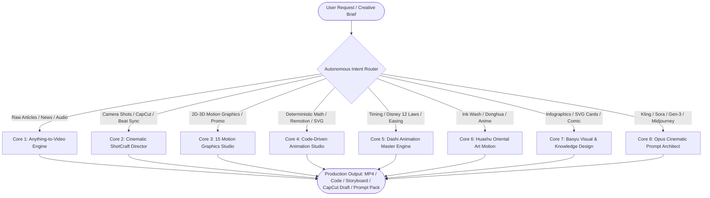

# 🎬 Omni Video Studio: Unified AI Video & Motion Graphics Engine

<div align="center">

[](https://opensource.org/licenses/MIT)
[](https://github.com/GanZnosuy/omni-video-studio)
[](https://github.com/GanZnosuy/omni-video-studio)
[](https://github.com/GanZnosuy/omni-video-studio)
[](https://github.com/GanZnosuy/omni-video-studio)
[](https://github.com/GanZnosuy/omni-video-studio)

**Universal Multi-Engine AI Video, Motion Graphics, Code Animation & Visual Storytelling Studio.**  
*Tự động phân loại, lựa chọn và thực thi pipeline tối ưu cho mọi tác vụ video, hoạt hình và thiết kế đồ họa.*

[English](#-english-overview) • [Tiếng Việt](#-tổng-quan-tiếng-việt) • [Installation](#-quick-install) • [Architecture](#-architecture) • [Modules](#-integrated-modules)

</div>

---

## 🌟 English Overview

**Omni Video Studio** is a unified, autonomous creative production platform for modern AI coding assistants (Antigravity, Claude Code, OpenAI Codex, Cursor, Windsurf). 

Instead of juggling 9 disparate plugins or writing monolithic prompts, Omni Video Studio features an **Autonomous Intent Router** that automatically classifies your request and dispatches it to the exact specialized sub-engine:
- **Multimodal Video**: Articles, text, and podcasts $\rightarrow$ fully voiced, scripted, and rendered videos.
- **Cinematography & Direction**: 124 Hollywood camera shot cards (dolly, orbit, vertigo, FPV drone) + CapCut/JianYing draft export.
- **Motion Graphics**: 15 distinct production styles (Isometric 3D, Flat Vector, Cel Boil, Kinetic Typography, Cyberpunk HUD).
- **Code Animation**: Deterministic, mathematically exact motion with Remotion (React), Motion Canvas, Three.js, and SVG (zero AI hallucinations).
- **Disney & Anime Principles**: 12 laws of animation, nonlinear cubic-bezier curves, squash & stretch.
- **Oriental Art Motion**: Chinese ink wash diffusion, martial arts Qi particles, and Donghua aesthetics.
- **Visual Design**: Baoyu visual hierarchy, SVG knowledge cards, and 4-panel comic strip storytelling.
- **Cinematic Prompt Architect**: Production-grade prompt formulas for Sora, Kling, Runway Gen-3, Luma, Midjourney v6, and Flux.
- **Gemini Autonomous Cookie Rotator**: Automatic CDP session harvesting to keep AI video reasoning tokens refreshed 24/7.

---

## 🇻🇳 Tổng quan Tiếng Việt

**Omni Video Studio** là siêu trạm sản xuất video, hoạt hình đồ họa chuyển động và thiết kế thị giác hợp nhất dành cho các trợ lý AI hàng đầu. 

Hệ thống tích hợp **Bộ định tuyến thông minh (Autonomous Intent Router)**: Người dùng chỉ cần ra lệnh tự nhiên, AI sẽ tự động phân tích và kích hoạt đúng lõi công nghệ phù hợp nhất:
1. **Chuyển đổi đa phương thức (Anything-to-Video)**: Biến bài viết, podcast, kịch bản thành video hoàn chỉnh với voiceover và nhạc nền.
2. **Đạo diễn điện ảnh (ShotCraft)**: 124 thẻ góc máy chuẩn Hollywood, mô phỏng camera 3D, xuất file draft CapCut / JianYing khớp từng nhịp nhạc.
3. **15 phong cách Motion Graphics**: Đồ họa phẳng, 3D trục đo (Isometric), hiệu ứng rung vẽ tay (Cel Boil), chữ động (Kinetic Typo), Tech HUD viễn tưởng.
4. **Hoạt hình bằng mã nguồn (Code Animation)**: Lập trình chuyển động bằng React Remotion, Motion Canvas, Three.js và Canvas 2D — chính xác từng mili-giây, tuyệt đối không bị ảo giác hình ảnh.
5. **Động lực học hoạt hình (Dashi Engine)**: Áp dụng 12 nguyên lý hoạt hình Disney & Anime (Squash & Stretch, Easing curves, Anticipation).
6. **Mỹ thuật Á Đông & Donghua (Huashu)**: Tranh thủy mặc loang màu, hiệu ứng nét cọ kiếm hiệp, hoạt hình tiên hiệp.
7. **Kiến trúc trực quan Baoyu**: Thẻ tóm tắt SVG độc lập, truyện tranh 4 ô giải thích khái niệm, slide thuyết trình đỉnh cao.
8. **Kiến trúc sư Prompt điện ảnh (Opus Prompting)**: Tạo prompt chuẩn 6 thành phần cho Kling, Sora, Gen-3, Runway, Midjourney.
9. **Tự động xoay Cookie Gemini**: Tự động trích xuất và đồng bộ session cookie qua Chrome CDP, đảm bảo tác vụ suy luận không bao giờ gián đoạn.

---

## 🏛️ Architecture



---

## 📦 Integrated Modules

| Module Directory | Core Capability | Technologies / Frameworks |
|---|---|---|
| [`modules/01_anything2video`](modules/01_anything2video) | Multimodal Text/Audio/Data to Video | Remotion, Script Gate, Dual-Audio Engine |
| [`modules/02_video_shotcraft`](modules/02_video_shotcraft) | 124 Hollywood Shot Cards & CapCut | JianYing/CapCut Draft Export, Beat Sourcing |
| [`modules/03_mg_styles_15`](modules/03_mg_styles_15) | 15 Motion Graphics Styles | Flat, Isometric 3D, Cel Boil, Kinetic Typo |
| [`modules/04_code_animation_studio`](modules/04_code_animation_studio) | Programmatic Deterministic Animation | Motion Canvas, Canvas 2D, p5.js, Three.js |
| [`modules/05_dashi_animation_style`](modules/05_dashi_animation_style) | Master Animation Dynamics | Disney 12 Principles, Cubic-Bezier Easing |
| [`modules/06_huashu_art_motion`](modules/06_huashu_art_motion) | Donghua & Oriental Ink Wash | Ink Diffusion, Qi Particles, Sword Trails |
| [`modules/07_baoyu_design`](modules/07_baoyu_design) | Knowledge Infographics & Comic Strips | Standalone SVG Cards, Visual Hierarchy |
| [`modules/08_opus_cinematic`](modules/08_opus_cinematic) | Opus Prompter & Camera Pathing | Sora, Kling, Gen-3, Runway, Midjourney v6 |
| [`tools/gemini_cookie_sync.py`](tools/gemini_cookie_sync.py) | Autonomous Cookie Rotator | Chrome DevTools Protocol (CDP) |
| [`tools/studio_router.py`](tools/studio_router.py) | CLI Intent Classifier | Automated Task Pipeline Selection |

---

## 🚀 Quick Install

### 1. For Google Antigravity
Clone directly into your global skills directory:
```bash
git clone https://github.com/GanZnosuy/omni-video-studio.git ~/.gemini/config/skills/omni-video-studio
```

### 2. For Claude Code
```bash
git clone https://github.com/GanZnosuy/omni-video-studio.git ~/.claude/skills/omni-video-studio
```

### 3. For OpenAI Codex / Cursor
```bash
git clone https://github.com/GanZnosuy/omni-video-studio.git ~/.codex/skills/omni-video-studio
```

### 4. Windows One-Click Setup (PowerShell)
```powershell
irm https://raw.githubusercontent.com/GanZnosuy/omni-video-studio/main/install.ps1 | iex
```

---

## 💡 Usage Examples

Once installed, simply converse with your AI agent naturally:
- *"Biến bài viết nghiên cứu này thành một video giải thích phong cách 3D Isometric kèm kịch bản chi tiết."*
- *"Tạo chuyển động camera Dolly Zoom lượn quanh nhân vật trong thành phố mưa neon để nạp vào Kling AI."*
- *"Tóm tắt kiến thức về kiến trúc Transformer thành một thẻ SVG Infographic chuẩn Baoyu."*
- *"Viết code React Remotion tạo hiệu ứng chữ nhảy động theo nhịp bài nhạc này."*
- *"Chuyển đoạn thơ cổ thành phân cảnh hoạt hình thủy mặc phong cách Donghua."*

---

## 🛡️ Security & Privacy
- **100% Sanitized**: Scanned with automated regex guards for zero hardcoded secrets, private keys, or API credentials.
- **Isolated State**: Session cookies and environment variables are strictly loaded from `.env` (ignored by git).

## 📄 License
Released under the [MIT License](LICENSE). Open-source, freely reusable for commercial and personal projects.
