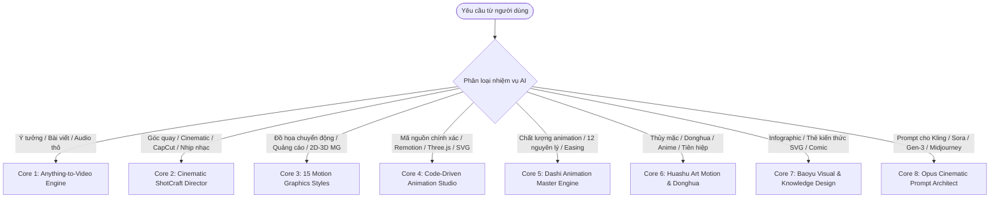

# 🎬 OMNI VIDEO STUDIO: UNIFIED PRODUCTION ENGINE

`omni-video-studio` là siêu trạm sản xuất video, đồ họa chuyển động (Motion Graphics), hoạt hình bằng mã nguồn (Code-driven Animation), mỹ thuật thị giác và kiến trúc sư Prompt điện ảnh toàn năng nhất. 

Trạm sản xuất tích hợp và hợp nhất 9 kho công nghệ tinh hoa:
1. **`anything2video`**: Động cơ chuyển đổi đa phương thức (Text/Image/Audio/Data $\rightarrow$ Video hoàn chỉnh).
2. **`video-shotcraft`**: 124 thẻ góc quay điện ảnh, chuyển động máy quay 3D, ánh sáng, nhịp điệu và xuất CapCut/JianYing.
3. **`mg-styles-15`**: 15 trường phái Motion Graphics chuyên nghiệp (Isometric 3D, Kinetic Typo, Tech HUD, Liquid...).
4. **`wtt-code-animation-studio`**: Hoạt hình bằng mã nguồn chính xác từng frame (Remotion, Motion Canvas, Three.js, Canvas, SVG).
5. **`dashi-animationstyle`**: 12 nguyên lý hoạt hình Disney & Anime, biểu đồ gia tốc (easing), nhịp điệu chuyển động.
6. **`huashu-art-motion`**: Mỹ thuật Donghua, tranh thủy mặc, hiệu ứng hạt tiên hiệp, thư pháp & bút pháp Á Đông.
7. **`baoyu-design`**: Kiến trúc trực quan Baoyu, Infographic kiến thức, thẻ tóm tắt SVG, Comic strip, Presentation.
8. **`xilo-opus-video`**: Công thức Prompt video điện ảnh cho Sora, Kling, Gen-3, Runway, Midjourney, Flux.
9. **`lemo-opuscar`**: Hệ thống Director đa tác nhân, điều phối quỹ đạo camera và mô phỏng vật lý xe / hành động.

---

## 🧭 BỘ ĐỊNH TUYẾN THÔNG MINH TỰ ĐỘNG (AUTONOMOUS INTENT ROUTER)

Khi nhận bất kỳ yêu cầu nào liên quan đến hình ảnh, hoạt hình, video hoặc thiết kế trực quan, AI sẽ **tự động phân tích và kích hoạt Core tương ứng** mà không cần người dùng phải chọn thủ công:



### BẢNG ĐIỀU PHỐI CHI TIẾT (DISPATCH MATRIX)

| Tình huống / Yêu cầu người dùng | Lõi được kích hoạt | Thư mục Module tương ứng | Sản phẩm đầu ra |
|---|---|---|---|
| Có bài viết, kịch bản, âm thanh podcast cần biến thành video đầy đủ | **Core 1: Anything2Video** | `modules/01_anything2video` | Kịch bản 2 bước, Remotion video, Voiceover, MP4 |
| Cần chỉnh góc máy, flycam, dolly zoom, timing nhịp nhạc, xuất CapCut | **Core 2: ShotCraft** | `modules/02_video_shotcraft` | Bảng phân cảnh 124 Shot, CapCut draft, timeline XML |
| Cần làm video giải thích (explainer), intro, typo kinetic, tech HUD | **Core 3: MG Styles** | `modules/03_mg_styles_15` | Prompt & Code 1 trong 15 phong cách MG chuẩn |
| Cần hoạt hình lập trình không bị ảo giác AI (deterministic math motion) | **Core 4: Code Animation** | `modules/04_code_animation_studio` | Code React Remotion, Motion Canvas TS, Three.js, p5.js |
| Cần chỉnh độ mượt, gia tốc chuyển động, squash & stretch | **Core 5: Dashi Engine** | `modules/05_dashi_animation_style` | Bảng timing sheet, cubic-bezier easing curves |
| Cần phong cách anime hành động, tiên hiệp kiếm hiệp, tranh thủy mặc | **Core 6: Huashu Motion** | `modules/06_huashu_art_motion` | Mỹ thuật Donghua, hiệu ứng nét cọ, hạt phong thủy |
| Cần tóm tắt kiến thức, infographic dạng thẻ, comic strip, slide | **Core 7: Baoyu Design** | `modules/07_baoyu_design` | File SVG độc lập, thẻ kiến thức chuẩn visual hierarchy |
| Cần câu lệnh Prompt chi tiết để nạp vào Kling, Sora, Runway, Midjourney | **Core 8: Opus Architect** | `modules/08_opus_cinematic` | Prompt chuẩn điện ảnh 6 thành phần: Subject + Lens + Light |

---

## ⚡ CHI TIẾT CÁC LÕI CÔNG NGHỆ CHUYÊN BIỆT

### CORE 1: MULTIMODAL ANYTHING-TO-VIDEO (`01_anything2video`)
Quy trình sản xuất video 6 giai đoạn nghiêm ngặt:
1. **Nghiên cứu & Định hướng**: Phân tích nội dung gốc, xác định tệp khán giả và thông điệp duy nhất.
2. **Cổng duyệt kịch bản 2 bước (Script Gate)**: Đề xuất 3 hướng tiếp cận $\rightarrow$ Chốt dàn ý $\rightarrow$ Viết kịch bản lời thoại chi tiết theo từng frame.
3. **Phân cảnh thị giác (Storyboard)**: Ánh xạ từng câu thoại sang một hành động cụ thể có thể dựng bằng mã nguồn hoặc sinh bằng hình ảnh.
4. **Hệ thống âm thanh kép (Dual-Audio Engine)**:
   - `audio_narration.wav`: Giọng đọc lồng tiếng sạch (16kHz/44.1kHz).
   - `audio.wav`: Bản phối âm hoàn chỉnh gồm BGM và Sound FX (SFX).
5. **Render & Khung hình quyết định (Deterministic Rendering)**: Đảm bảo render lặp lại cùng kết quả nhờ cố định Random Seed và Frame Number.
6. **Kiểm duyệt 3 vòng (Jury Review)**: Đánh giá độ rõ của chữ trên màn hình điện thoại, nhịp độ và tính hấp dẫn trước khi xuất MP4.

### CORE 2: CINEMATIC SHOTCRAFT & DIRECTOR (`02_video_shotcraft`)
Kho 124 thẻ góc quay điện ảnh tiêu chuẩn Hollywood:
- **Quỹ đạo chuyển động máy quay**:
  * `Truck Left/Right`, `Dolly In/Out`, `Pedestal Up/Down`.
  * `Orbit 360`, `Spiral Ascend/Descend`, `Whip Pan`, `Crash Zoom`.
  * `Vertigo Effect (Hitchcock Dolly Zoom)`: Zoom tiêu cự ngược hướng di chuyển của camera.
  * `FPV Drone Dive`: Góc nhìn thứ nhất nhào lượn góc hẹp.
- **Ống kính & Tiêu cự**:
  * `14mm - 24mm`: Góc siêu rộng (Ultra-wide), kéo dãn chiều sâu không gian, tăng tốc độ thị giác.
  * `35mm - 50mm`: Góc nhìn tự nhiên tương đương mắt người (Natural Eye).
  * `85mm - 135mm`: Chân dung điện ảnh, độ nén hậu cảnh cao (Shallow Depth of Field / Bokeh).
- **Hệ thống ánh sáng (Lighting Setup)**: Chiaroscuro tương phản cao, Rembrandt Lighting, Volumetric God Rays, Cyberpunk Neon rim lights.
- **Tích hợp CapCut / JianYing**: Tự động sinh file dự án draft CapCut hoặc XML import trực tiếp lên timeline với track âm thanh và video đã chia sẵn nhịp.

### CORE 3: 15 MOTION GRAPHICS STYLES (`03_mg_styles_15`)
Bộ sưu tập 15 phong cách đồ họa chuyển động hoàn chỉnh:
1. `01-flat-vector`: Tối giản, hình khối phẳng sắc nét, màu sắc bão hòa vừa phải.
2. `02-line-art`: Nét vẽ kỹ thuật, đường mảnh chuyển động liên hoàn.
3. `03-isometric`: Không gian 3 chiều trục đo, phối cảnh kiến trúc và công nghệ.
4. `04-3d-render`: 3D mềm mại phong cách Claymorphism hoặc PBR hiện đại.
5. `05-cel-boil`: Hiệu ứng rung vẽ tay truyền thống (Hand-drawn boiling lines).
6. `06-collage`: Cắt dán ảnh báo chí, phong cách tạp chí nghệ thuật (Mixed media).
7. `07-liquid`: Chuyển động chất lỏng, chảy mềm và hợp nhất giọt nước.
8. `08-morph`: Biến hình hình học liên tục (Seamless shape morphing).
9. `09-bauhaus`: Mỹ thuật Bauhaus cổ điển Đức, phối hợp màu đỏ - vàng - xanh - đen.
10. `10-synthwave`: Thập niên 80, lưới neon tím hồng, ánh sáng viền retro.
11. `11-cyberpunk-hud`: Giao diện tương lai, dữ liệu số, radar và chỉ số công nghệ.
12. `12-aurora-glass`: Kính mờ phủ màu cực quang (Glassmorphism + Aurora gradients).
13. `13-kinetic-typo`: Chữ chuyển động theo nhịp điệu giọng nói (Typography explosion).
14. `14-pixel-art`: Phong cách game 8-bit / 16-bit cổ điển hoài niệm.
15. `15-minimal-editorial`: Tạp chí cao cấp, khoảng trắng rộng, typography thanh lịch.

### CORE 4: CODE-DRIVEN ANIMATION STUDIO (`04_code_animation_studio`)
Sản xuất chuyển động bằng mã nguồn thuần túy:
- **Remotion (React & TypeScript)**: Tạo video bằng linh kiện React, CSS Flexbox/Grid, hỗ trợ hot-reload và render serverless.
- **Motion Canvas**: Lập trình chuyển động toán học theo generator `yield* all(...)` trực quan, cực kỳ mạnh cho giải thích thuật toán, toán học và khoa học máy tính.
- **Three.js & WebGL**: Hiển thị vật thể 3D, shader tùy biến, ánh sáng thực và hoạt hình xương (Skeletal animation).
- **Canvas 2D / p5.js**: Mô phỏng hạt vật lý, fractal, sóng âm thanh tương tác.
- **SVG SMIL & Lottie**: Hoạt hình vector dung lượng siêu nhẹ, sắc nét ở mọi độ phân giải màn hình.

### CORE 5: DASHI MASTER ANIMATION DYNAMICS (`05_dashi_animation_style`)
Áp dụng 12 định luật hoạt hình vào AI Video & Code:
- **Squash and Stretch**: Độ đàn hồi của vật thể khi chạm bề mặt để tạo cảm giác trọng lượng và thể tích.
- **Anticipation**: Động tác chuẩn bị (ví dụ: khuỵu chân trước khi bật nhảy) giúp khán giả nắm bắt diễn biến.
- **Easing Formula**: Không bao giờ dùng `linear`. Bắt buộc sử dụng đường cong `cubic-bezier(0.25, 0.1, 0.25, 1.0)` hoặc `spring(mass, stiffness, damping)`.
- **Follow Through & Overlapping Action**: Quán tính của các bộ phận mềm (tóc, vạt áo, đuôi) di chuyển chậm hơn cơ thể chính.

### CORE 6: HUASHU ORIENTAL ART MOTION & DONGHUA (`06_huashu_art_motion`)
Mỹ thuật Á Đông đặc trưng:
- **Thủy mặc khuếch tán (Ink Wash Diffusion)**: Giọt mực loang trên giấy xuyến chỉ (Rice paper texture), vệt cọ thư pháp khô và ướt.
- **Động tác võ thuật & Tiên hiệp**: Chuyển động đường kiếm kèm vệt sáng hạt khí (Sword trail & Qi particles), khinh công đạp gió, cánh hoa đào bay trong gió xoáy.
- **Ánh sáng hoàng hôn & Sương mù cổ trang**: Màu vàng hổ phách, lam ngọc, khói mờ ảo tạo chiều sâu mỹ học phương Đông.

### CORE 7: BAOYU VISUAL & KNOWLEDGE ARCHITECTURE (`07_baoyu_design`)
Thiết kế đồ họa trực quan hàng đầu:
- **Thẻ tóm tắt SVG (Knowledge Card)**: Bố cục lưới vàng (Golden ratio grid), phân cấp tiêu đề - biểu tượng - số liệu - diễn giải.
- **Truyện tranh 4 ô (Comic Strip Storytelling)**: Khởi - Thừa - Chuyển - Hợp biến mọi khái niệm trừu tượng thành câu chuyện trực quan.
- **Bảng số liệu & Infographic**: Thiết kế biểu đồ sạch sẽ, tối ưu khả năng đọc lướt trên màn hình di động (Thumb-friendly mobile readability).

### CORE 8: OPUS CINEMATIC PROMPT ARCHITECT (`08_opus_cinematic`)
Bộ ngữ pháp Prompt chuẩn xác nhất cho các mô hình AI Video hiện đại (Sora, Kling, Runway Gen-3, Luma, Midjourney v6):
```
[GÓC MÁY & TIÊU CỰ] + [CHỦ THỂ & TRẠNG THÁI] + [HÀNH ĐỘNG CỤ THỂ] + [MÔI TRƯỜNG & CHI TIẾT ĐỘNG] + [ÁNH SÁNG & TONE MÀU] + [THÔNG SỐ MÁY QUAY & TỐC ĐỘ]
```
- *Ví dụ mẫu*:
  > `Low-angle tracking shot, 35mm anamorphic lens: A weathered Vietnamese artisan in indigo linen meticulously chiseling lacquerware. Wood dust particles float through warm morning volumetric sunlight beaming through wooden blinds. Shallow depth of field, slow dolly-in motion, 4k cinematic grading, cinematic film grain, 24fps.`

---

## 🚀 QUY TRÌNH THỰC THI CHUẨN CỦA AGENT KHI NHẬN LỆNH

1. **Phân tích yêu cầu**: Nhận diện loại nội dung và phong cách mà người dùng mong muốn.
2. **Kích hoạt tự động**: Tự động áp dụng tri thức từ Core tương ứng mà không bắt người dùng phải cấu hình rườm rà.
3. **Cung cấp giải pháp đa tầng**:
   - Giai đoạn 1: Lập dàn ý & Kịch bản phân cảnh (Storyboard) với chi tiết góc máy, ánh sáng, chuyển động.
   - Giai đoạn 2: Cung cấp mã nguồn thực thi (Remotion / Motion Canvas / SVG) hoặc Prompt trích xuất cho các công cụ AI Video.
   - Giai đoạn 3: Tích hợp âm thanh, nhịp điệu và hướng dẫn xuất video hoàn chỉnh.
